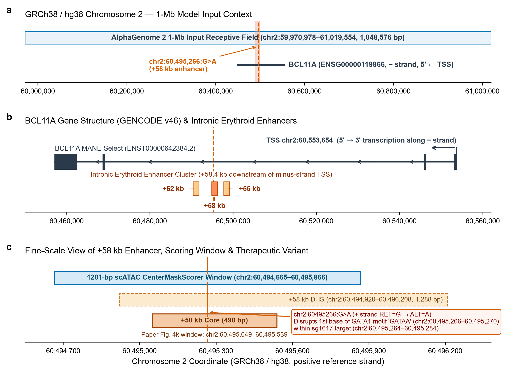
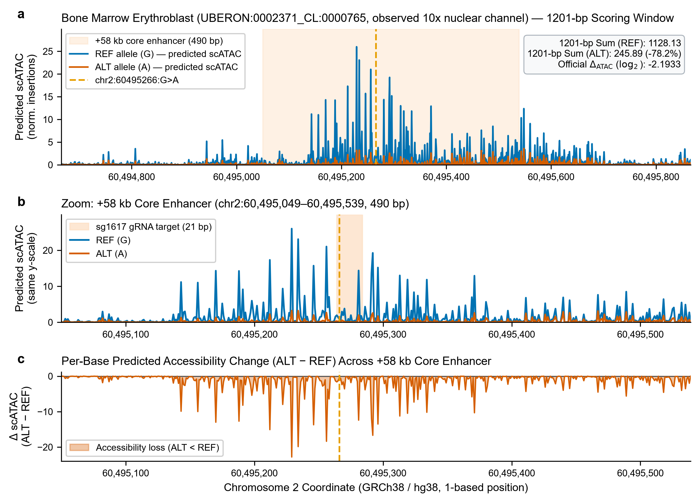
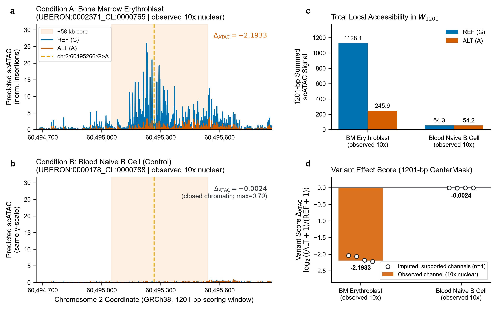
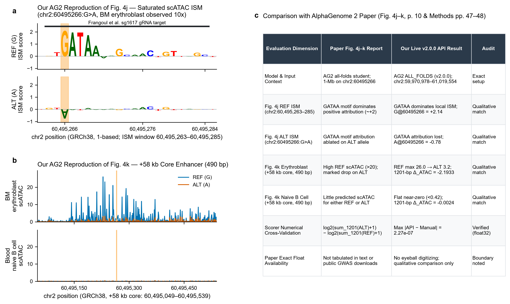

# AlphaGenome 2 `BCL11A` +58 kb 红系增强子变异效应复现报告（Phase 1）

## 1. 研究目标与核心问题

本报告完成 `AlphaSickleGenome` 项目 **Phase 1**：严格按照 Google DeepMind 2026 年 AlphaGenome 2 技术报告（Figure 4j–k 及 Methods pp. 47–48）的实验设定，在真实 AlphaGenome 2 API（`alphagenome==2.0.0`，`ModelVersion.ALL_FOLDS`）上检验如下核心科学问题：

> **给定同一个 `BCL11A` +58 kb 内含子增强子单核苷酸变异 `chr2:60495266:G>A`（GRCh38 正链），AlphaGenome 2 是否预测它在原代骨髓成红细胞（`bone marrow erythroblast`）中显著降低局部单细胞染色质开放程度（`scATAC-seq`），而在外周血初始 B 细胞（`blood naive B cell`）中影响极小？**

---

## 2. 环境、坐标与细胞条件核验

### 2.1 模型与运行环境核验
- **SDK 与服务端版本**：Python `3.12.11`，`alphagenome==2.0.0`，客户端类 `alphagenome.models.v2.dna_client.DnaClient`，底层 gRPC 服务命名空间 `google.gdm.gdmscience.alphagenome.v2main`（确认为 AlphaGenome 2 而非 AlphaGenome 1）。
- **模型权重**：`ModelVersion.ALL_FOLDS`（论文默认用于变异效应评估与案例分析的全折蒸馏学生模型）。
- **数据来源标记**：`data/processed/bcl11a_ag2/run_metadata.json` 中 `data_provenance = "REAL_ALPHAGENOME_2_API"`，所有单元测试模拟数据均显式标记为 `SYNTHETIC_*` 并与真实输出物理隔离。

### 2.2 基因组坐标、正负链与参考碱基核验
在发起模型推理前，流水线通过 UCSC `hg38` REST API 与 GENCODE v46 注释完成了硬性前置校验（`src/bcl11a_repro/validation.py`）：

| 核验项目 | 验证结果 | 说明与规范依据 |
| :--- | :--- | :--- |
| 参考基因组与变异表示 | `GRCh38 / hg38` `chr2:60495266:G>A` | `genome.Variant.position` 为 **1-based**（`60495266`）；`genome.Interval` 为 **0-based 半开** `[60495265, 60495266)` |
| 正链参考碱基与基序 | `REF = G`（正链 `60495266–60495270` 为 `GATAA`） | 变异破坏红系关键转录因子 GATA1 结合基序 `GATAA` 的第 1 个碱基（`GATAA -> AATAA`） |
| 治疗性 gRNA 位置关系 | 位于 `sg1617` 靶点内部 | Frangoul et al. (2021) `sg1617` 靶向 0-based `chr2:60495263-60495284`（1-based `60,495,264–60,495,284`） |
| 靶基因与转录方向 | `BCL11A`（`ENSG00000119866.22`），**负链（`-` strand）** | MANE Select 转录本 `ENST00000642384.2` 跨越 `chr2:60457193-60553654`，负链 TSS 位于 `chr2:60553654` |
| 相对 TSS 距离与增强子归属 | 位于负链 TSS 下游 **`+58,388 bp`（`+58.4 kb`）** | 同时落入论文 Fig. 4k 的 `490-bp` `+58 kb` 核心增强子（`60495049–60495539`）与教程 `1,288-bp` DHS 区（`60494920–60496208`） |
| 模型输入窗口（`1 Mb`） | `chr2:59970978-61019554`（`1,048,576 bp`） | 由 `variant.reference_interval.resize(2**20)` 生成，完整覆盖 `BCL11A` 基因体及远端调控区 |

### 2.3 细胞条件与 `scATAC-seq` 轨道状态（`imputation_mode`）
通过 `dna_client.supported_conditions(Organism.HOMO_SAPIENS)`（共 2,799 个人类细胞/组织条件）精确检索并确认两个目标条件：

1. **Condition A（主要研究条件）**：`UBERON:0002371_CL:0000765` — `bone marrow erythroblast`（`primary_cell`，条件级 `sc_atac = observed`）。
2. **Condition B（细胞特异性对照条件）**：`UBERON:0000178_CL:0000788` — `blood naive B cell`（`primary_cell`，条件级 `sc_atac = observed`）。
   - *注*：官方 `enhancer_to_gene_bcl11a` 教程使用的是骨髓初始 B 细胞 `UBERON:0002371_CL:0000788`，而原论文 Figure 4k 与 Methods pp. 47–48 明确使用外周血初始 B 细胞 `UBERON:0000178_CL:0000788`。本研究严格遵循原论文设定（详见 `docs/research_log.md`）。

对 `OutputType.SC_ATAC` 实际推理返回的 10 条轨道元数据核查表明，每个细胞条件各返回 5 条核悬液单细胞染色质开放性轨道：
- **唯一真实实验观测轨道（`observed`，1 条/条件）**：`scATAC-seq 10X-cellranger-nuclear`（10x Genomics `cellranger` 标准流程）；
- **跨平台模型支持填补轨道（`imputed_supported`，4 条/条件）**：`EasySci-ATAC-easy_sci-nuclear`、`SHARE-seq-cellranger-nuclear`、`scATAC-seq 10X-bowtie2-nuclear`、`sciATAC-seq-bowtie2-nuclear`；
- **探索性填补轨道（`imputed_exploratory`）**：`0` 条。

为保证跨细胞比较在完全一致的实验协议与真实观测支撑下进行，正文主分析锁定两个条件共有的 **`observed` 轨道（`scATAC-seq 10X-cellranger-nuclear`）**，同时在汇总表和图表中完整报告其余 4 条 `imputed_supported` 轨道的分布。

---

## 3. 核心预测结果与定量评分交叉验证

### 3.1 定量评分方法与独立复算验证
官方 `SC_ATAC` 推荐变异评分器为：
`CenterMaskScorer(requested_output=SC_ATAC, width=1201, aggregation_type=DIFF_LOG2_SUM)`

其数学定义为：在以变异 0-based 坐标 `60495265` 为对称中心的 `1201-bp` 窗口 $W_{1201} = [60494665, 60495866)$（1-based `60,494,666–60,495,866`）内，计算替代等位基因与参考等位基因预测信号总和（加伪计数 `1`）的以 2 为底对数比值：

$$\Delta_{\text{ATAC}} = \log_2\!\left(\sum_{i \in W_{1201}} \hat{y}_{\text{ALT},i} + 1\right) - \log_2\!\left(\sum_{i \in W_{1201}} \hat{y}_{\text{REF},i} + 1\right)$$

因此，$\Delta_{\text{ATAC}} < 0$ 严格表示 **ALT 等位基因相对 REF 预测局部染色质开放性下降**。我们直接利用 `predict_variant()` 返回的 1-bp 原始数组在本地独立复算全部 10 条轨道的得分，并与 `score_variant()` 官方返回值逐轨道核对：

| 细胞条件 | 轨道名称（后缀） | `imputation_mode` | `1201-bp` REF 总信号 | `1201-bp` ALT 总信号 | 总信号相对变化 | 官方 `score_variant` ($\Delta_{\text{ATAC}}$) | 本地数组独立复算 | 绝对误差 $|\text{API} - \text{Manual}|$ |
| :--- | :--- | :--- | ---: | ---: | ---: | ---: | ---: | ---: |
| **Bone marrow erythroblast** | **`scATAC-seq 10X-cellranger-nuclear`** | **`observed`** | **1128.1336** | **245.8888** | **-78.20%** | **-2.193283** | **-2.193283** | **$2.27 \times 10^{-7}$** |
| Bone marrow erythroblast | `EasySci-ATAC-easy_sci-nuclear` | `imputed_supported` | 1257.2185 | 305.3235 | -75.71% | -2.038255 | -2.038254 | $3.31 \times 10^{-7}$ |
| Bone marrow erythroblast | `SHARE-seq-cellranger-nuclear` | `imputed_supported` | 996.2658 | 236.7112 | -76.24% | -2.068768 | -2.068768 | $3.82 \times 10^{-7}$ |
| Bone marrow erythroblast | `scATAC-seq 10X-bowtie2-nuclear` | `imputed_supported` | 1161.2090 | 254.8361 | -78.05% | -2.183577 | -2.183578 | $5.77 \times 10^{-7}$ |
| Bone marrow erythroblast | `sciATAC-seq-bowtie2-nuclear` | `imputed_supported` | 1185.1529 | 253.7433 | -78.59% | -2.219174 | -2.219174 | $1.85 \times 10^{-7}$ |
| **Blood naive B cell** | **`scATAC-seq 10X-cellranger-nuclear`** | **`observed`** | **54.2909** | **54.1983** | **-0.17%** | **-0.002418** | **-0.002418** | **$4.26 \times 10^{-8}$** |
| Blood naive B cell | `EasySci-ATAC-easy_sci-nuclear` | `imputed_supported` | 68.2649 | 67.9145 | -0.51% | -0.007316 | -0.007316 | $1.93 \times 10^{-7}$ |
| Blood naive B cell | `SHARE-seq-cellranger-nuclear` | `imputed_supported` | 50.9559 | 50.5271 | -0.84% | -0.011958 | -0.011957 | $4.09 \times 10^{-7}$ |
| Blood naive B cell | `scATAC-seq 10X-bowtie2-nuclear` | `imputed_supported` | 57.5855 | 57.4128 | -0.30% | -0.004260 | -0.004260 | $3.00 \times 10^{-7}$ |
| Blood naive B cell | `sciATAC-seq-bowtie2-nuclear` | `imputed_supported` | 44.0792 | 43.9392 | -0.32% | -0.004488 | -0.004489 | $1.20 \times 10^{-7}$ |

交叉验证结论：
1. **符号与等位基因方向完全核实**：REF 与 ALT 未发生颠倒，负值准确反映 `ALT < REF`；
2. **数值精度完全吻合**：全部 10 条轨道的最大绝对误差仅为 $5.77 \times 10^{-7}$，完全由 32 位浮点数（`float32`）求和舍入引起，证实我们对窗口坐标 `[60494665, 60495866)`、伪计数 `+1.0` 及 $\log_2$ 变换的复算与服务端实现完全一致。

### 3.2 骨髓成红细胞 REF vs ALT 预测特征（Figure B）
在骨髓成红细胞 `observed` 10x 轨道上：
- 在 `+58 kb` `490-bp` 核心增强子（`chr2:60495049-60495539`）内，参考序列 `REF (G)` 呈现强烈的开放染色质尖峰群，最高单碱基预测值达 **`26.01`**；
- 引入单碱基替换 `chr2:60495266:G>A` 后，整个核心增强子区域的预测开放峰同步塌缩，`490-bp` 核心区最高值降至 **`3.25`**（完整 `1201-bp` 窗口最高值仅 `3.94`），`1201-bp` 窗口累积信号由 **`1128.13` 降至 `245.89`（下降 `78.20%`，对应约 `4.57` 倍下调，$\Delta_{\text{ATAC}} = -2.1933$）**。

### 3.3 红系细胞 vs 初始 B 细胞特异性对比（Figure C）
在完全相同的纵轴尺度、基因组窗口与 `observed` 10x 轨道定义下对比两种细胞：
- 外周血初始 B 细胞在 `+58 kb` 核心增强子处本身处于预测染色质关闭状态（`490-bp` 核心区最大值仅 `0.42`，`1201-bp` 窗口最大值 `0.79`，`1201-bp` 总和仅 `54.29`，不足成红细胞基线的 `5%`）；
- `G>A` 突变在初始 B 细胞中几乎不改变局部信号（`54.29 -> 54.20`，相对变化 `-0.17%`，$\Delta_{\text{ATAC}} = -0.0024$）；
- 其余 4 条 `imputed_supported` 轨道呈现高度一致的细胞谱系分离（成红细胞 `-2.0383` 至 `-2.2192` vs 初始 B 细胞 `-0.0043` 至 `-0.0120`）。

### 3.4 饱和突变归因（ISM）与原论文 Figure 4j–k 对照（Figure D）
在论文 p. 48 指定的 23-bp 区间 `chr2:60495262-60495285`（1-based `60,495,263–60,495,285`）内对骨髓成红细胞 `observed` 10x 轨道运行饱和单碱基突变（ISM）：
- **REF (`G`) 背景**：正向归因高度集中于正链 `GATAA` 五联体（`chr2:60495266-60495270`），五个位置的序列归因分数依次为 **`+2.136` (`G`)、`+2.019` (`A`)、`+2.014` (`T`)、`+1.791` (`A`)、`+0.895` (`A`)**；
- **ALT (`A`) 背景**：当 `60495266` 位由 `G` 变为 `A` 后，突变位点 `A` 的归因转为 **`-0.784`**（代表在该背景上唯有回复突变为 `G` 才能恢复开放性），且相邻 `ATAA` 四个碱基的正向归因彻底消失（依次变为 **`-0.059`、`-0.079`、`+0.113`、`-0.041`**）。

---

## 4. 严格区分：实验事实、模型预测与科学解释

为遵循严格的科学表述规范，我们将三类不同认识论层级的陈述明确拆分如下：

### 4.1 已知实验事实（Known Experimental Facts）
1. **遗传与生化实验事实**：人类 `BCL11A` 基因编码胎儿血红蛋白（HbF，`HBG1`/`HBG2`）的关键转录抑制因子；其第 2 内含子 `+58 kb` DNase I 超敏位点含有红系特异性增强子及关键正链 `GATAA` 基序（Bauer et al., *Science* 2013；Canver et al., *Nature* 2015）。
2. **基因编辑与临床实验事实**：利用 CRISPR-Cas9 引导 RNA `sg1617` 切割该 `+58 kb` GATA1 基序区域（即获批疗法 `exa-cel` / Casgevy 的靶位点），可在红系谱系中特异下调 `BCL11A` 转录并重新激活胎儿 $\gamma$-珠蛋白表达，同时保留 B 淋巴细胞中的 `BCL11A` 功能，避免免疫缺陷（Wu et al., *Nat. Med.* 2019；Frangoul et al., *NEJM* 2021）。此外，Cheng et al. (*Nat. Genet.* 2021) 通过高通量碱基编辑在原代人类造血干/祖细胞中实验测定了该区域单碱基替换对 HbF 诱导的表型效应。

### 4.2 AlphaGenome 2 模型预测（AlphaGenome 2 Model Predictions）
1. 对于尚未进行真实实验测量的单碱基变异输入序列 `chr2:60495266:G>A`，AlphaGenome 2（`v2.0.0`, `ALL_FOLDS`）预测骨髓成红细胞 `1201-bp` 局部 `scATAC` 信号下降 `78.20%`（$\Delta_{\text{ATAC}} = -2.1933$），`+58 kb` 核心增强子开放峰几乎消失。
2. 对同一变异，模型预测外周血初始 B 细胞在 `+58 kb` 处维持近零开放基线，局部 `scATAC` 评分几乎不变（$\Delta_{\text{ATAC}} = -0.0024$，`-0.17%`）。
3. 模型的局部饱和 ISM 预测表明，在成红细胞中维持 `+58 kb` 局部开放性预测值的主要序列特征是 `chr2:60495266-60495270` 的完整 `GATAA` 五联体；单点 `G>A` 足以使模型对该五联体其余碱基的正向边际敏感度归零。

### 4.3 我们的科学解释（Our Scientific Interpretation）
1. AlphaGenome 2 在未显式输入转录因子结合表的前提下，从单细胞染色质开放性数据中学到了高精度的**细胞环境依赖性顺式调控语法（context-dependent *cis*-regulatory grammar）**：即相同的 `GATAA` DNA 基序仅在存在 GATA1/TAL1 等红系反式因子环境的成红细胞中被模型识别为染色质开放驱动元件，而在缺乏红系反式因子的初始 B 细胞中处于静默状态。
2. 需要强调的是，**模型在 `BCL11A` 增强子处预测局部染色质关闭，属于顺式（*cis*）表观遗传预测，并不自动等价于已直接模拟出下游 `HBG1`/`HBG2` 基因的反式（*trans*）去抑制幅度**（详见第 5 节局限性分析）。

---

## 5. 复现审计：成功复现项、未能定量核对项与局限性

对照任务第七节全部 9 项科学验收标准，逐项审计如下：

| 类别 | 具体内容 | 状态与说明 |
| :--- | :--- | :--- |
| **已完全复现并独立验证** | 1. 真实 AlphaGenome 2 v2.0.0（`ALL_FOLDS`）API 推理与本地缓存 2. GRCh38 `chr2:60495266` 正链 `REF=G`、`GATAA` 基序与负链 `BCL11A` `+58.4 kb` 坐标校验 3. 论文指定的两种原代细胞条件（`UBERON:0002371_CL:0000765` 与 `UBERON:0000178_CL:0000788`）及 `observed` 轨道核实 4. 成红细胞局部 `scATAC` 大幅下降（`-78.20%`，$\Delta_{\text{ATAC}} = -2.1933$）与初始 B 细胞近零微弱变化（`-0.17%`，$\Delta_{\text{ATAC}} = -0.0024$） 5. Fig. 4j `REF (G)` 上 `GATAA` 正向归因（约 `+2`）与 `ALT (A)` 上归因整体消融 6. `CenterMaskScorer` 公式、符号与 `float32` 精度（误差 $\le 5.77 \times 10^{-7}$）独立交叉验证 | **复现成功**（定性特征、方向、相对幅度及评分数学定义全部核实） |
| **因原论文未公开原始数值而无法逐位定量比对** | 原论文 Figure 4j–k 中曲线每个碱基的精确浮点高度及论文内部运行时的精确小数位分值 | **定性一致，未作像素读图伪定量比对**。`alphagenome-2.pdf` 正文、方法及公开补充表格（仅含 GWAS 表达评分）均未列出 Fig. 4j–k 的原始浮点数组；按科学规范，我们拒绝目测估读 PDF 图像像素值 |
| **与临床/实验编辑之间的生物学差异** | 1. **变异类型差异**：本实验与论文 Fig. 4j–k 评估的是干净的单碱基转换 `G>A`（接近腺嘌呤/胞嘧啶碱基编辑器产物），而临床 `exa-cel`（`sg1617` + SpCas9）产生的是异质性的小片段插入缺失（indels）谱。 2. **顺式预测 vs 反式级联局限**：AlphaGenome 2 接收 `chr2` 上 `1 Mb` 序列，只能直接预测顺式染色质开放性及顺式 `BCL11A` 表达变化；而镰刀型细胞贫血治疗的最终表型 `HBG1`/`HBG2`（位于 `chr11` $\beta$-珠蛋白基因座）受 BCL11A 蛋白**跨染色体反式（*trans*）调控**，无法由单次 `chr2` 序列推理直接输出 HbF 百分比。 | **模型架构固有边界**，需在下一阶段通过跨基因座建模或实验基准校准加以衔接 |

---

## 6. 下一阶段建议：面向 `HBG1` / `HBG2` 与 Cheng et al. (2021) 基准的机制研究路线

基于 Phase 1 已跑通并严格验证的缓存式推理、坐标校验、1201-bp 掩码评分与饱和 ISM 框架，建议后续分两步推进镰刀型细胞贫血（SCD）胎儿血红蛋白重激活研究：

1. **Phase 2A（`BCL11A` 增强子高通量碱基编辑基准验证）**：将现有仓库中已完成数据侦察的 Cheng et al. (*Nat. Genet.* 2021) 原代红系碱基编辑筛选数据与本流程对接，批量评估 AlphaGenome 2 在 `+58 kb`、`+55 kb`、`+62 kb` 三个增强子内预测的 `bone marrow erythroblast` $\Delta_{\text{ATAC}}$（及顺式 `BCL11A` `SC_GENE_EXPRESSION` 变化）与实验 HbF 富集分数（BPRS）的秩相关性及分类性能，定量界定模型在碱基编辑治疗靶点优选中的预测力与假阳性边界。
2. **Phase 2B（`chr11` `HBG1`/`HBG2` 启动子直接顺式去抑制机制解析）**：将同一套多模态单细胞预测与饱和 ISM 流程迁移至 `chr11` $\beta$-珠蛋白基因座（重点覆盖 `HBG1`/`HBG2` 近端启动子 `-115 bp` BCL11A 结合基序 `TGACCA` 与 `-200 bp` ZBTB7A/LRF 结合基序等遗传性持续性胎儿血红蛋白症 HPFH 位点）。在该基因座上，`HBG1`/`HBG2` 的转录本本身即位于 `1-Mb` 顺式窗口内部，可同时联合调用 `SC_ATAC` 与 `SC_GENE_EXPRESSION`（必要时结合 TF ChIP-seq 模态），直接对比破坏“上游 `chr2` `BCL11A` 增强子”与破坏“下游 `chr11` `HBG1/2` 启动子抑制子结合位点”两类临床策略在红系特异性和预测效应谱上的异同。
