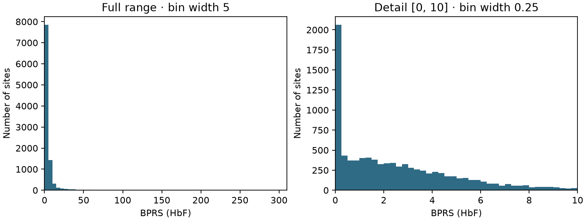

# HbF 筛选数据侦察

Cheng 等（2021）的出版社原版合订工作簿含表 4 和表 6。两页第 1 行是标题，第 2 行空白，第 3 行是字段名。下文只统计数据行。[论文与方法](https://pmc.ncbi.nlm.nih.gov/articles/PMC8628368/) · [下载原始 XLSX](https://static-content.springer.com/esm/art%3A10.1038%2Fs41588-021-00861-8/MediaObjects/41588_2021_861_MOESM3_ESM.xlsx)

本地文件 `data/raw/41588_2021_861_MOESM3_ESM.xlsx`，SHA-256 为 `4d82029f0ffb649dd067bb8eb4c5f98aa7446164cde2ebf24c5b18e2c4a87edd`。重新下载到该路径后，运行 `uv run --script src/data_recon.py` 可重建报告及图；脚本联网读取 UCSC hg19 参考区段。

## 工作表与缺失值

dtype 按 pandas 3.1.1 读取结果。缺失按空单元格或读入 NA 统计，数值 0 计作观测值。

### Supplementary_table _4（6,213 行）

| 实际列名 | dtype | 字段解释 | 缺失数 | 缺失比例 |
| --- | --- | --- | --- | --- |
| `sgRNA` | str | guide 的序列标识，每行一条 | 0 | 0.00% |
| `Element` | str | 筛选靶调控元件的区间标签，或对照类别；不是单碱基坐标 | 0 | 0.00% |
| `HbFlow (normalized read counts)` | str | HbF 低组两个重复的归一化 guide 读数，以 / 分隔 | 0 | 0.00% |
| `HbFhigh (normalized read counts)` | str | HbF 高组两个重复的归一化 guide 读数，以 / 分隔 | 0 | 0.00% |
| `LFC(Log fold change)` | float64 | guide 在高组相对低组的对数倍数变化；正值表示高组富集 | 0 | 0.00% |
| `FDR` | float64 | guide 层面差异丰度检验的多重检验校正值 | 0 | 0.00% |

### Supplementary_table _6（10,156 行）

| 实际列名 | dtype | 字段解释 | 缺失数 | 缺失比例 |
| --- | --- | --- | --- | --- |
| `Adenine` | str | 可编辑 A 的 hg19 单碱基区间及其所在链 | 0 | 0.00% |
| `BPRSHbF` | float64 | 该 A 的筛选统计分数；数值越大，支持差异富集的证据越强 | 0 | 0.00% |

表 4 有 6,213 条不同 guide，其中 6,174 行带染色体区间，其余 39 行为对照（Nontargeting × 20、positive_high × 8、positive_moderate × 5、positive_modest × 5、g34 positive high × 1）。区间标签中 851 行采用点分格式。两个读数列应分别保留重复；0/0 表示两个重复均为零。

## 位点、组装与等位基因

表 6 没有 locus 列。按论文四个筛选区域与染色体一一对应分组，统计整个靶区，含远端元件。区间全部长 1 bp，按染色体与起点检查无重复。下表范围给出最外侧被测碱基的 hg19 一基坐标，中间并非连续覆盖。

| 筛选区域 | 染色体 | 独立位置数 | 最小–最大位置 | 正链参考核对 |
| --- | --- | --- | --- | --- |
| BCL11A | chr2 | 2529 | 57,724,756–61,118,600 | [2529/2529](https://api.genome.ucsc.edu/getData/sequence?genome=hg19;chrom=chr2;start=57724755;end=61118600) |
| HBG / β-globin cluster | chr11 | 2566 | 4,167,375–5,831,928 | [2566/2566](https://api.genome.ucsc.edu/getData/sequence?genome=hg19;chrom=chr11;start=4167374;end=5831928) |
| KLF1 | chr19 | 3057 | 12,936,425–13,832,313 | [3057/3057](https://api.genome.ucsc.edu/getData/sequence?genome=hg19;chrom=chr19;start=12936424;end=13832313) |
| MYB–HBS1L | chr6 | 2004 | 135,373,036–135,773,015 | [2004/2004](https://api.genome.ucsc.edu/getData/sequence?genome=hg19;chrom=chr6;start=135373035;end=135773015) |

判定为 **hg19（GRCh37）**。作者生成可编辑区间时调用 hg19.fa，并用 BED 起点和 gRNA 内偏移生成单碱基区间。上表进一步逐行比较 UCSC hg19 序列与链标记。[组装来源](https://github.com/YichaoOU/ABE_NonCoding_functional_score/blob/cef8dbbd74e5f9359feb6cf709fccaac1127cd80/per_A_base_score/get_editable_A_positioin/main.py#L60) · [坐标算法](https://github.com/YichaoOU/ABE_NonCoding_functional_score/blob/cef8dbbd74e5f9359feb6cf709fccaac1127cd80/per_A_base_score/get_editable_A_positioin/get_editable_bp_per_gRNA.py#L20-L39)

给定的 GRCh38 BCL11A TSS 60,553,654 和 +58 kb DHS 60,494,920–60,496,208 符合负链基因下游坐标递减的关系。这两个锚点属于另一套组装，不能直接拿来筛表 6。BCL11A 的转录方向也不能代替每行 A 的链标记。

两表均无独立 REF/ALT 列。表 6 的 `chrom:start-end±` 是零基半开区间。若表示为 hg19 正链、一基位置，`pos = start + 1 = end`；行末 + 对应 A→G，− 对应 T→C。要构造目标 GRCh38 的四元组，还需做组装转换，检查唯一的单碱基映射、映射方向（翻转时取互补）及 GRCh38 REF，并按模型接口的位置约定编码。这里仅核对了源组装。

## BPRS 分布、符号与高分尾部

| 分位点 | BPRSHbF（线性插值） |
| --- | --- |
| 0% | 0.000000 |
| 1% | 0.000000 |
| 5% | 0.000000 |
| 10% | 0.000000 |
| 25% | 0.536919 |
| 50% | 2.241676 |
| 75% | 4.673962 |
| 90% | 8.888937 |
| 95% | 17.129786 |
| 99% | 81.785088 |
| 100% | 305.465869 |

1,492 个零值（14.69%），0 个负值。分布在零和低分区集中，右尾很长。在图示箱宽下看不到两个清晰分离的主体峰；这是图形描述，未做模态检验。

作者从 guide FDR 出发，除以对应位置的经验编辑频率，上限截为 1；多个 guide 覆盖一个 A 时用经验 Brown 法合并，最后取 −log10。计算不带入 LFC 符号，正 BPRS 既不能解释为 HbF 升高，也不能解释为降低。截至 1 可产生零分；代码给原始 FDR 加 10⁻³⁰⁰，极端高分受数值处理影响。[分数实现](https://github.com/YichaoOU/ABE_NonCoding_functional_score/blob/cef8dbbd74e5f9359feb6cf709fccaac1127cd80/per_A_base_score/define_functional_score/get_functional_score.py#L46-L79)

表 4 的 LFC 保留 guide 层面的方向，高组相对低组富集为正，耗减为负。举例取该列最大、最小值两行查看原始重复。

| 表 4 Excel 行 | HbF 低组 | HbF 高组 | LFC |
| --- | --- | --- | --- |
| 4 | 2.3734/6.9212 | 272.09/293.85 | 5.652 |
| 3534 | 9.4934/10.382 | 0/0 | -3.4512 |

你尚未指定高效应阈值。下表仅复核论文预测任务使用的高分界限 t = 30（含端点），不设本项目的分类阈值。全表 ≥30 有 313 个，≤10 有 9,268 个，与论文方法中的两组规模一致。分数绝对值等于原值，高分计数不能解释为上调或下调的变异数。[论文 Methods](https://pmc.ncbi.nlm.nih.gov/articles/PMC8628368/)

| 区域 | 总数 | BPRS ≥ +30 | BPRS ≤ −30 | 双尾合计 |
| --- | --- | --- | --- | --- |
| BCL11A | 2529 | 70 | 0 | 70 |
| HBG / β-globin cluster | 2566 | 103 | 0 | 103 |

## 后续解释的边界

HbF 高低分选是在细胞表型层做的测量；表 6 给每个碱基分配的分数，是从 guide 丰度和编辑窗口推断的证据强度。一个 guide 能覆盖多个 A，一个 A 也能被多个 guide 覆盖，相邻行可能共享筛选信号。直接把 guide 的 LFC 赋给每个 A 会引入未经验证的方向。因此，模型与 BPRS 排序一致时，所支持的是分子预测与 HbF 筛选信号的关联；单碱基 HbF 改变量、方向和中间调控步骤仍需各自的证据。
